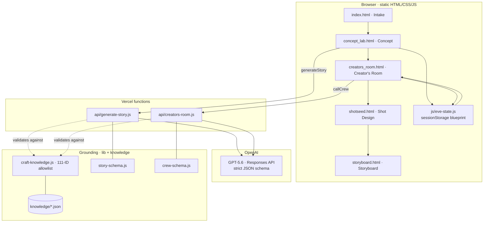

# Architecture

E.V.E Creator is a static front end plus two GPT-5.6 serverless endpoints. There is no
build step and no runtime dependency — every file is directly inspectable. State flows
through the browser (sessionStorage) across a five-step guided pipeline.

## System overview

## Request lifecycle

1. **Intake** stores the chosen format + target contest in `sessionStorage`.
2. **Concept Lab** POSTs the idea to `api/generate-story.js`. The endpoint calls GPT-5.6
   with `lib/system-prompt.js` + the strict `STORY_SCHEMA`, then **validates and repairs**
   the output (act order, shot numbering, runtime math) and **drops any citation** not in
   the 111-ID allowlist. A rich client fallback (`js/eve-api.js`) covers offline/error.
3. **The Creator's Room** POSTs the draft blueprint to `api/creators-room.js`. A second
   GPT-5.6 pass returns a structured critique (`lib/crew-schema.js`): five role verdicts,
   dimension deltas, and concrete shot revisions. Citations are filtered; the claimed score
   gain is **capped at +30**. `js/eve-crew.js` provides a deterministic fallback derived
   from the blueprint itself, so the demo is compelling even with no API key.
4. **Apply** folds the revisions back into the blueprint (`applyRevisions`) and saves the
   improved version, which **Shot Design** and **Storyboard** consume.

## Why these choices

- **Strict structured output + citation allowlist** turns the model from a confident
  guesser into a grounded reasoner: it can only cite craft IDs that actually exist.
- **Two bounded passes** (each `reasoning.effort: low`, 40s timeout) keep real agentic
  behavior inside serverless limits.
- **Deterministic fallbacks** make every step demo-safe without a key.
- **No build step / zero deps** keeps the whole system auditable — important for a project
  whose entire pitch is *trustworthy, grounded* reasoning.

See also: [`SYSTEM_DESIGN.md`](SYSTEM_DESIGN.md), [`SCHEMA.md`](SCHEMA.md), [`SCHEMA_L2.md`](SCHEMA_L2.md).
