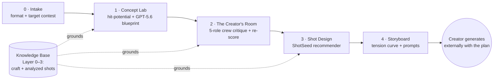

<div align="center">

# 🎬 E.V.E Creator

### Learn to direct a film — even if you've never studied one.

**A shared learning platform for anyone curious about AI film and AI art. Bring an idea; an AI film crew designs the whole film *and teaches you why every choice works* — grounded in frame-level analysis of master animation. Then you make it yourself.**

> 🎓 **OpenAI Build Week — Education track.** E.V.E turns filmmaking's hidden craft into something a beginner can learn by doing: every cited technique is tap-to-learn, and a five-role AI crew shows you *why* it critiques and fixes your film.

[](https://github.com/playlist0726-code/eve-creator/actions/workflows/ci.yml)
[](LICENSE)
[](https://eve-creator.vercel.app)
[](#-how-gpt-56-is-used)
[](#-how-codex-built-this)

**🔗 [Live demo](https://eve-creator.vercel.app) · 🎥 [Demo video](https://youtube.com) · 🏆 OpenAI Build Week Challenge**

</div>

---

## The problem

Making even a 3-minute animated short means weeks of pre-production most people never learn: story structure, shot grammar, pacing, symbolic staging, and — with AI generators — writing dozens of precise prompts. Beginners don't know *why* a shot works, and generic "AI story" tools just hand back a plausible-sounding draft with no craft behind it and no way to tell if it's any good.

## The solution

**E.V.E Creator** turns one idea (mood · genre · scene · premise) into a complete, *grounded* pre-production plan: story → five-act structure → storyboard → per-shot image (T2I) and video (I2V) prompts → recommended generation tools. It does **not** generate the film for you — it designs exactly *how* to make it, and you keep authorship and run the generation.

Every decision is **grounded**: not "AI-invented advice," but reasoning tied to a knowledge base built from **frame-by-frame analysis of master animation** (Pixar / Disney) and researched film craft.

> **Measured, not claimed:** in our evaluation a grounded blueprint scored **25/25** against a naive prompt's **10/25**. See [`evaluation/`](evaluation/).

---

## ⭐ The differentiator — The Creator's Room

Most "idea → storyboard" tools are one-shot: prompt in, draft out. E.V.E adds a step nobody else has.

**The Creator's Room** is a **reflection / self-critique loop**. GPT-5.6 role-plays a five-person film crew, each with a distinct — and sometimes conflicting — lens:

| Role | Guards | Reacts to |
|------|--------|-----------|
| 🟡 **Director** | Story spine, theme, emotional truth | Beats that don't serve the controlling idea |
| 🔵 **Writer** | Logline clarity, causality, the twist | Weak setups/payoffs, vague stakes |
| 🟢 **Cinematographer** | Framing, angle, movement, symbolic mise-en-scène | Craft that doesn't match a shot's dramatic function |
| 🟠 **Editor** | Pacing, tension curve, runtime discipline | Flat stretches, mistimed peaks |
| 🟣 **Test Audience** | Hook strength, clarity, shareability | What's confusing, boring, or unforgettable |

The crew **critiques the draft against the craft knowledge base, applies concrete before/after fixes to specific shots, and re-scores the film's hit-potential.** The UI shows each member speak in turn, the score animate from v1 → v2, and every applied fix as a before/after diff — then hands the *improved* blueprint to the next step.

Score gains are justified by the revisions (capped at +30), and every citation is validated against a 111-ID allowlist, so the crew can't hallucinate evidence or inflate itself.

---

## 🎓 Learn while you build (Education)

E.V.E is built for people who never studied film. Instead of a separate "course," the teaching is woven into the act of making:

- **Tap-to-learn craft, everywhere.** Every technique E.V.E cites — `low_angle`, `chiaroscuro`, `pixar_spine`, and 108 more — is a **learnable term**. Tap any chip and get a plain-language explanation of what it is and *what it does to the audience* (`js/eve-glossary.js`, all 111 grounded IDs covered).
- **The crew explains its reasoning.** In the Creator's Room, each fix is attached to a real principle and a before/after example, so you learn *why* a change makes the film better — like sitting in a director's room.
- **Then make it yourself.** The pipeline ends with copy-ready image (T2I) and video (I2V) prompts and recommended tools. E.V.E hands you the plan and the vocabulary; **you generate the film and keep authorship.**

The result: a beginner finishes with a shootable film *and* a working understanding of the craft behind it.

## How it works — the guided pipeline



Grounding is layered:

- **Layer 0 — Knowledge base** ([`knowledge/`](knowledge/)): 7 researched JSON datasets — story structures, cinematography, mise-en-scène, genres, director styles, success factors, AI toolchain.
- **Layer 1 — ShotSeed shot data**: real Pixar/Disney shots analyzed frame-by-frame (2D / 3D), with palettes extracted from source frames.
- **Layer 2 — Narrative & pacing** ([`SCHEMA_L2.md`](SCHEMA_L2.md)): structure, twist mechanics, tension curves.
- **Layer 3 — Reference upload**: drop in a reference short → analyze it on the fly (roadmap).

---

## 🤖 How GPT-5.6 is used

GPT-5.6 is used **agentically, not as a single prompt:**

1. **Director blueprint** (`api/generate-story.js`) — turns one idea into a dense five-act, 12–18-shot blueprint via the **Responses API with strict JSON-schema structured output** ([`lib/story-schema.js`](lib/story-schema.js)). Every shot must cite 2–5 IDs from a **111-ID craft allowlist**; hallucinated citations are dropped server-side.
2. **The Creator's Room** (`api/creators-room.js`) — a **second GPT-5.6 pass** that role-plays five specialists reviewing the draft and returns a structured critique: per-role verdicts, re-scored dimensions (before → after), and concrete shot revisions ([`lib/crew-schema.js`](lib/crew-schema.js), [`lib/crew-prompt.js`](lib/crew-prompt.js)). This is the self-critique loop.

Both endpoints run server-side (key never exposed), are bounded (`reasoning.effort: low`, hard 40s timeout), validate and repair the model output, and fall back to a **rich deterministic result** so the live demo never breaks.

## 🛠 How Codex built this

This project was built **with Codex** as the pair-programmer:

- Codex scaffolded the GPT-5.6 engine — the Responses-API handler, the strict JSON schema, the system prompt, and the client fetch/fallback layer (`api/`, `lib/`, `js/eve-api.js`).
- Codex wrote and iterated the Node test suite (`tests/`) that guards the citation contract, runtime math, and pipeline hand-off.
- Codex handled the English rebrand (SceneForge → E.V.E Creator), the file renames, and the Vercel deploy config.
- Human + Codex then added **The Creator's Room** — schema, prompt, endpoint, deterministic fallback, and the animated review UI.

See [`CODEX_HANDOFF.md`](CODEX_HANDOFF.md) for the running brief passed to Codex between sessions.

---

## Run it locally

```bash
git clone https://github.com/playlist0726-code/eve-creator.git
cd eve-creator
npm test            # runs the full contract + pipeline + Creator's Room suite

# Static pages work with any static server:
npx serve .         # then open http://localhost:3000/index.html

# For the live GPT-5.6 endpoints, deploy on Vercel and set one env var:
cp .env.example .env         # add your server-side key
#   OPENAI_API_KEY=sk-...
```

The site is fully usable offline: without a key, the Concept Lab and Creator's Room use their curated/deterministic fallbacks.

---

## Project structure

```
eve-creator/
├── index.html            # 0 · Intake / Home — pipeline, differentiator, evidence
├── concept_lab.html      # 1 · Concept Lab — hit-potential + GPT-5.6 blueprint
├── creators_room.html    # 2 · ★ The Creator's Room — 5-role crew critique + re-score
├── shotseed.html         # 3 · Shot Design — shot recommender + dataset browser
├── storyboard.html       # 4 · Storyboard — tension curve + per-shot prompts
├── api/                  # Vercel serverless (GPT-5.6): generate-story.js · creators-room.js
├── lib/                  # story-schema · system-prompt · craft-knowledge · crew-schema · crew-prompt
├── js/                   # eve-api · eve-state · eve-crew (client logic + fallbacks)
├── knowledge/            # Layer 0 knowledge base — 7 researched JSON datasets
├── evaluation/           # Grounded-vs-Naive experiment (25 vs 10)
├── tests/                # Node test suite (run via `npm test`)
├── data/contests.json    # Curated real AI-film competitions for the Intake step
├── ARCHITECTURE.md · SUBMISSION.md · VISION.md · SYSTEM_DESIGN.md
└── SCHEMA.md · SCHEMA_L2.md · RESEARCH_PLAN.md · CODEX_HANDOFF.md
```

## Tech stack

Static HTML / CSS / vanilla JS (no build step) · Vercel serverless functions · **OpenAI GPT-5.6** (Responses API, strict structured output) · Node test suite · GitHub Actions CI. Zero runtime dependencies by design — the whole thing is inspectable.

## Testing

```bash
npm test
```

Covers: the 111-ID citation contract, the five-act runtime math, the guided-pipeline hand-off, and the Creator's Room crew loop (five roles, valid citations, applied revisions, server-schema acceptance). CI runs it on every push.

## Roadmap

- [x] Grounded GPT-5.6 director blueprint + citation validation
- [x] The Creator's Room — 5-role self-critique loop
- [x] Grounded-vs-naive evaluation (25 vs 10)
- [ ] Reference upload → on-the-fly shot analysis (Layer 3)
- [ ] Generate the storyboard animatic in-app (visceral output)
- [ ] Expand ShotSeed dataset with 2D/3D tagging

---

## License & author

[MIT](LICENSE) © 2026 **Junsu (Michael) Kim** — AI filmmaker. Built for the OpenAI Build Week Challenge with Codex + GPT-5.6.
